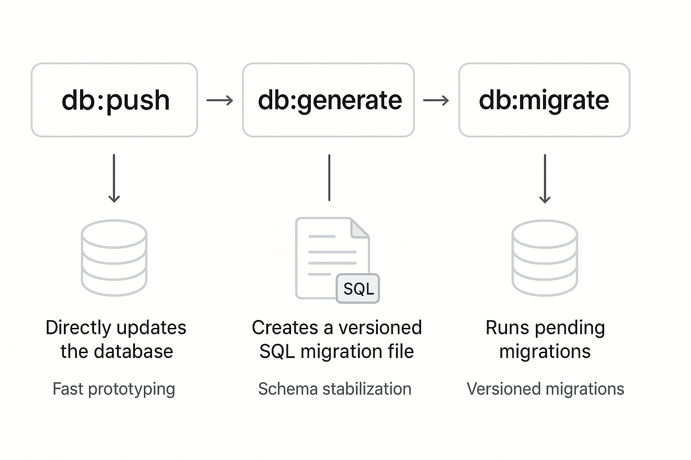

## Tech Stack

- **Backend:** Express + tRPC + Drizzle ORM + PostgreSQL
- **Frontend:** React + TanStack Router + tRPC Client
- **Build:** TypeScript strict mode + Biome + Vitest

## Prerequisites

- Node.js 24+
- Docker (for PostgreSQL)
- [mise](https://mise.jdx.dev/) (task runner)

## Quick Start

```bash
# 1. Install dependencies
mise setup

# 2. Start services and seed database
mise reset

# 3. Start development
mise dev
```

## Project Structure

```
fullstack-starter/
├── api/                   # Backend API
│   ├── routes/v1+/        # OpenAPI routes (external API)
│   ├── trpc/              # tRPC routers (dashboard)
│   ├── services/          # Business logic
│   └── databases/         # Drizzle schema
│
├── dashboard/             # React SPA
│   └── app/routes/        # Pages
│
└── assets/components/ui/  # Shared UI components
```

## Available Commands

| Command | Description |
|---------|-------------|
| `mise setup` | Install dependencies |
| `mise reset` | Reset development environment |
| `mise dev` | Start API + dashboard in watch mode |
| `mise check` | Type check + lint |
| `mise test` | Run tests |
| `mise clean` | Clean node_modules and logs |
| `mise api <cmd>` | Run API CLI commands |
| `mise ui add <component>` | Add a shadcn/ui component into `assets/components/ui/` (omit `<component>` for the interactive picker) |

### API CLI Commands

| Command | Description |
|---------|-------------|
| `mise api start` | Start API server |
| `mise api db:gen` | Generate SQL migration file |
| `mise api db:migrate` | Run pending SQL migrations |
| `mise api db:push` | Push schema changes |
| `mise api db:seed` | Seed database |

### Database Workflow



- **db:push** — Directly updates the database. Use during fast prototyping.
- **db:generate** — Creates a versioned SQL migration file. Use when schema is stable.
- **db:migrate** — Runs pending migrations. Use for versioned deployments.

## Authentication

**Dashboard (session-based):**
- Login at `http://localhost:3000/login`
- Test credentials: `test@example.com` / `password123`
- Session persists in browser cookies
- tRPC calls include session cookie automatically

**API (API key-based):**
- Include `X-Api-Key: <key>` header in requests
- API key shown after running `mise up` or `mise api db:seed`

### Auth Flow: OpenAPI vs tRPC

**OpenAPI routes (external API via API key):**
```typescript
// X-Api-Key header → middleware → ctx.apiKey
// ctx.apiKey.userId gives the user who owns the API key
// ctx.user is NULL (no session)
async handler({ ctx, response }) {
  if (!ctx.apiKey) {
    return response.unauthorized({ error: "API key required" });
  }
  const userId = ctx.apiKey.userId; // Use this!
}
```

**tRPC routes (dashboard via session):**
```typescript
// Session cookie → Better Auth → ctx.user
// ctx.user.id gives the logged-in user
// ctx.apiKey is NULL (no API key)
protectedProcedure.query(({ ctx }) => {
  const userId = ctx.userId; // Use this!
});
```

## Reference Examples

A worked `posts` resource is threaded through every layer (schema, service, tRPC router, OpenAPI routes, webhook, seed data, tests, and UI) to demonstrate the pattern end to end. Swap it out for your own domain.

- OpenAPI pattern: `api/routes/v1+/posts+/$id+/index.ts` (GET endpoint)
- tRPC pattern: `api/trpc/init.ts`
- UI components: `assets/components/ui/`
